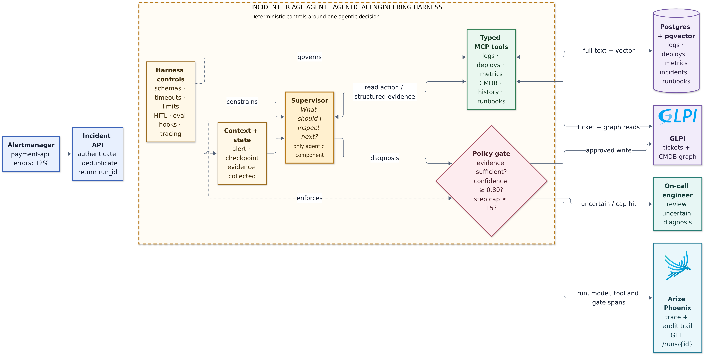

# Incident Triage Agent

An evidence-driven incident investigation system. It starts from an alert on a
downstream service, follows logs and CMDB dependencies, identifies the likely
root cause, and either prepares a governed ticket update or escalates to the
on-call engineer.

The agentic boundary is deliberately narrow: the model decides **what evidence
to inspect next**. Data access, step limits, confidence policy, approval, writes,
and audit reconstruction remain deterministic.



## What happens during an incident

1. Prometheus detects an elevated error rate and Alertmanager calls
   `POST /webhooks/incident`.
2. FastAPI fingerprints the alert, returns `202 Accepted` with a stable
   `run_id`, and prevents retry duplication.
3. One bounded LangGraph supervisor selects typed MCP read tools for logs,
   deployments, CMDB dependencies, past incidents, and runbooks.
4. A deterministic gate checks confidence and evidence. Uncertain cases stop
   for human review; writes require an approval token.
5. OpenTelemetry spans are stored in Phoenix, and `GET /runs/{run_id}`
   reconstructs the investigation.

There is one supervisor, not a crew. A diagnosis written to an ITSM ticket
needs one reconstructable decision path.

## Measured results

The reproducible offline evaluation contains 30 labelled cases: real incidents,
clean alerts, concurrent failures, inconclusive cases, and efficiency cases.

| Measure | Result |
|---|---:|
| Root-cause accuracy on diagnosable cases | 95.7% (22/23) |
| Missed incidents | 1 |
| False-alarm rate | 14.3% |
| Causal-trail violations | 0 |
| Mean tool calls | 4.87 |
| Auto-resolution rate | 76.7% |
| Chaos scenarios | 6/6 passed |

Both CI hard gates pass: missed incidents are at most one, and causal-trail
violations are zero. See [the generated evaluation report](evals/REPORT.md).

These numbers use frozen run artifacts, not live model calls. The chaos suite
is a deterministic dependency-signal harness. Separately, the Docker path was
verified live from an injected `auth-service` failure through Prometheus,
Alertmanager, the webhook, the supervisor, Phoenix, and the audit API; the
result identified `postgres-main` after five tool steps.

## Why the historical logs are synthetic

Loghub HDFS was evaluated and rejected: its sample contained 2,000 lines—1,920
INFO, 80 WARN, and zero ERROR—and represented Hadoop replication rather than
service incidents. It could not test pool exhaustion, OOM failures, deploy
regressions, or dependency cascades.

The repository therefore uses 19,654 synthetic historical log lines with
explicit causal structure across seven failure patterns. Live toy-service
failures remain real. Synthetic data with the right causal structure is more
useful here than real data from the wrong operational domain.

## Stack

| Concern | Technology |
|---|---|
| Agent runtime | LangGraph Graph API, one ReAct supervisor |
| Tool boundary | Two MCP servers, 11 typed tools |
| API | FastAPI |
| ITSM and CMDB | GLPI |
| Operational storage | PostgreSQL + pgvector |
| Tracing and audit | OpenTelemetry + Arize Phoenix |
| Alert path | Prometheus + Alertmanager |
| Delivery | Docker, GitHub Actions, GHCR, Render Blueprint, Helm |

## Run locally

Prerequisites: Docker Desktop, Python 3.14, and a copy of `.env.example` saved
as `.env` with the required GLPI and model credentials.

```bash
python3.14 -m venv .venv
.venv/bin/python -m pip install -r requirements-dev.txt
docker compose up -d
.venv/bin/python scripts/run_api.py
```

The main endpoints are:

```text
GET  /health
POST /webhooks/incident
GET  /runs/{run_id}
POST /runs/{run_id}/approve
```

Inject and clear the local auth dependency fault:

```bash
curl -X POST http://localhost:9002/fault
curl -X POST http://localhost:9002/recover
```

Run all verification:

```bash
make test
make eval
make chaos-suite
docker build -t incident-triage-agent:local .
```

## Deployment

- GitHub Actions runs linting, type checks, 123 tests, the two evaluation
  gates, the chaos suite, and the Docker build. Pushes to `main` publish to
  GHCR.
- The API image uses `requirements-api.txt`; local MCP embedding workflows use
  the full `requirements.txt`. This keeps PyTorch and model weights out of the
  web-service image.
- `render.yaml` defines a Docker web service and keeps integration credentials
  outside source control.
- `helm/incident-triage-agent` provides a non-root Kubernetes deployment,
  probes, resource limits, optional ingress, and optional autoscaling.

## Limitations

- The runnable demo handler currently supports the verified `payment-api`
  incident path; the tool layer and goldens cover the wider 12-service topology.
- Alert fingerprints and graph checkpoints are stored in memory. A production
  deployment needs a durable run ledger, queue, and checkpointer.
- Historical logs and CMDB topology are synthetic and intentionally bounded to
  12 services.
- The published evaluation replays frozen agent outputs. A release benchmark
  should rerun all 30 cases against the selected live model and retain the raw
  traces.
- The six-case chaos suite validates dependency-guided reasoning
  deterministically; only the primary cascade has been verified through the
  complete live Docker alert path.
- No auto-remediation is implemented. The system diagnoses and governs writes;
  it does not change production services.

For the design rationale and trust boundaries, see
[Technical Architecture](docs/TECHNICAL_ARCHITECTURE.md).
